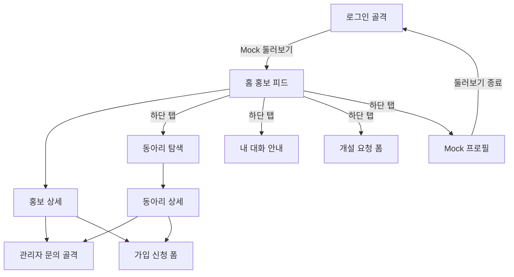
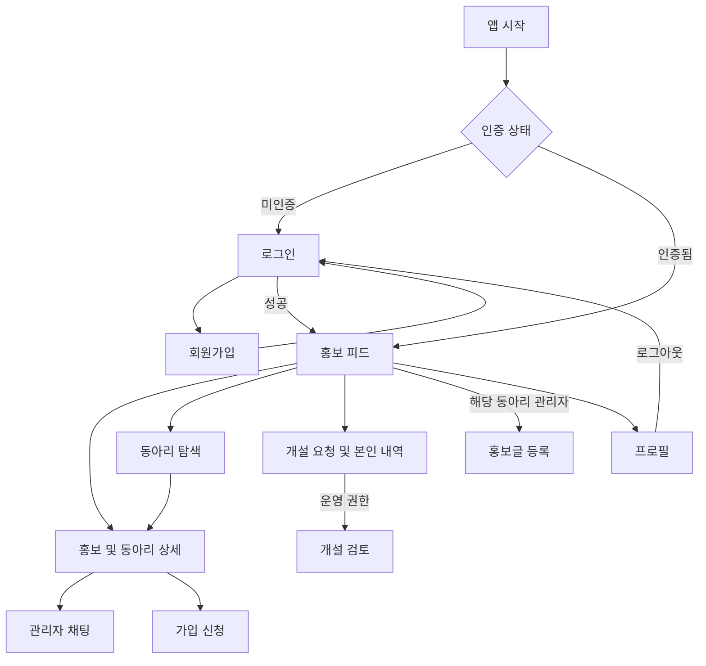

# 화면 흐름

## 현재 Mock 템플릿

실제 route와 연결을 기준으로 작성했다. 실선은 현재 이동 가능하다. 채팅·신청은 화면만 이동하며 서버 동작은 없다.

하단 5개 탭은 상호 이동 가능하며 위 그림은 홈에서의 진입을 대표로 표시한다. 상세·문의·가입의 뒤로 버튼은 직전 화면으로 돌아간다. Mock 둘러보기 진입 시 로그인 화면을 백스택에서 제거하고, 종료 시 탐색 기록을 제거한다. 실제 Auth 보호 경계는 NAV-01/AUTH-02에서 구현한다.

| route | 화면/인자 | 현재 상태 | 후속 |
|---|---|---|---|
| auth | 로그인, 로컬 입력 | Mock 진입만 활성 | 회원가입 경로, AuthViewModel |
| home | 홍보 목록 | Mock 목록·상태 표시 | Firestore 연결·등록 진입 |
| search | 검색·카테고리 | Mock 검색/필터 | 실제 목록·디자인 |
| promotion/{id} | 홍보+동아리 상세 | id로 조회, 문의/가입 연결 | 개별 오류 재시도 |
| club/{id} | 동아리 상세 | id로 조회 | 실제 정보 연결 |
| chats | 내 대화 | 빈 안내만 | 방 목록 클릭·방 ID 이동 |
| chat/{clubId} | 관리자 문의 | 대상 ID 안내 | 방 생성 후 roomId 기반 채팅 |
| requests | 개설 요청·내역 안내 | 로컬 폼, 제출 비활성 | 내역·상태·검토 경로 |
| apply/{clubId} | 가입 신청 | 로컬 폼, 제출 비활성 | 독립 MembershipScreen 및 저장 |
| profile | Mock 방문자 | 둘러보기 종료 | 실제 사용자·로그아웃 |

## 최종 목표 동선 (미구현 포함)

인증이 필요한 사용자 행동은 로그인 상태 확인 후 실행한다. Firestore Rules에서도 동일한 소유자·참여자 권한을 검증한다. 권한 없는 링크 진입·존재하지 않는 ID·삭제된 대상은 안내와 복귀 경로를 제공한다. 회원가입 성공 후 이동 정책(직접 홈 또는 로그인)은 AUTH-01 계약 리뷰에서 확정한다. 위 목표도는 로그인 복귀안이다.

수요조사 화면은 MVP에서 개설 목적 입력에 포함한다. 독립 설문·투표 기능은 구현하지 않는다. 관리자 홍보 작성·개설 검토·가입 내역의 상세 디자인은 Figma 확인 후 확정한다.
